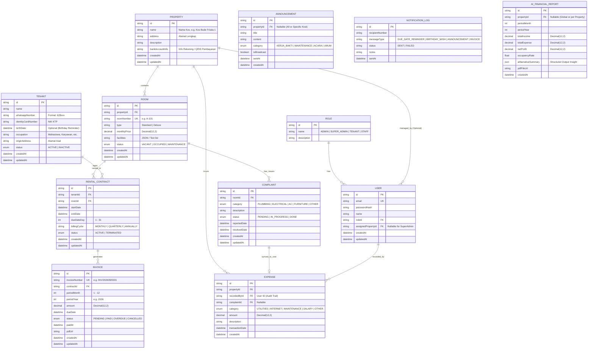
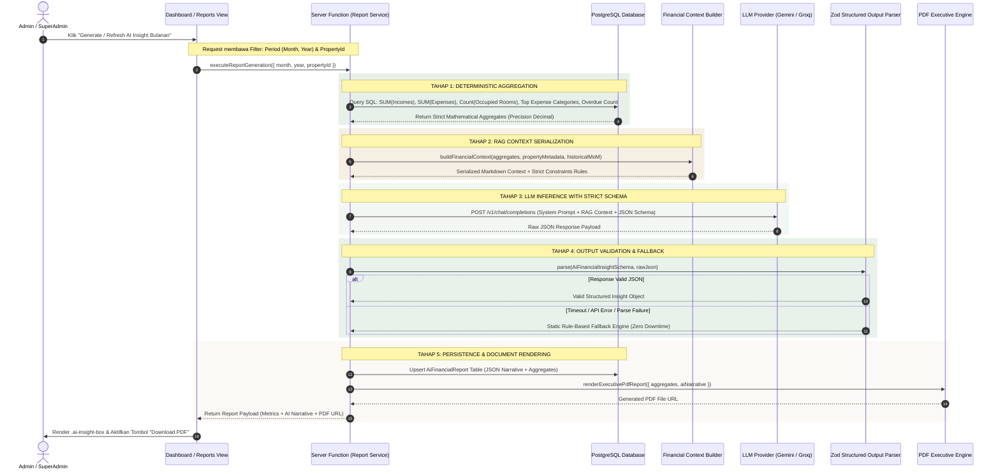
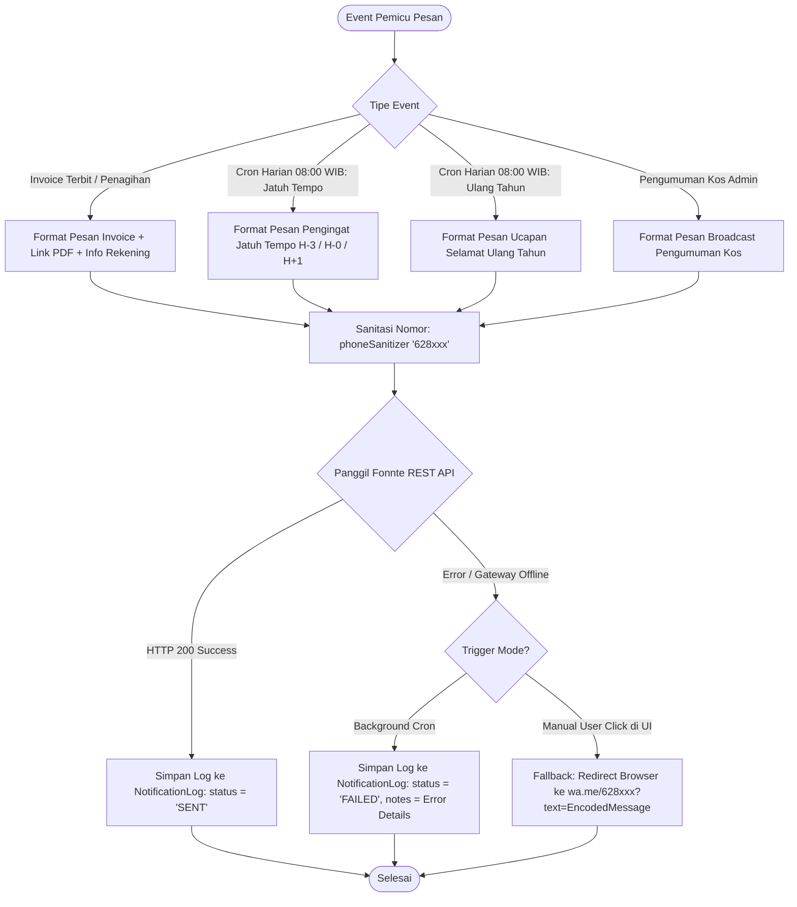
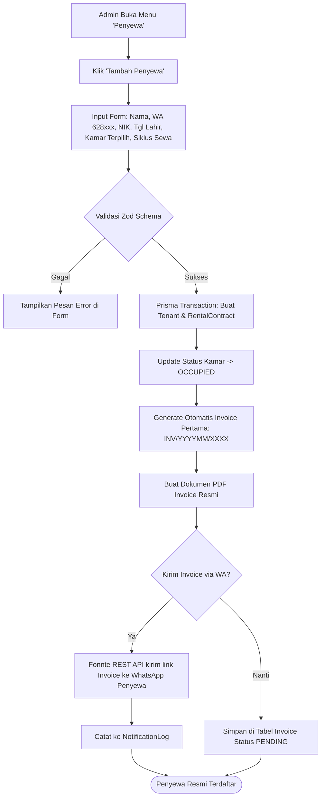

# System Architecture Documentation — HomeeKost (Multi-Property Kost Management)

> **Versi Dokumen**: 1.0.0  
> **Status**: Production Architecture Blueprint  
> **Target Rilis**: HomeeKost Enterprise Monolith (Phase 0 – Phase 10)  
> **Sifat Sistem**: SSR Monolith (Full-Stack Type-Safe) + Multi-Property RBAC + Automated WhatsApp Engine + AI Financial Intelligence (RAG Engine)

---

## 1. Executive Summary & Visi Sistem

**HomeeKost** adalah platform pengelolaan operasional kos-kosan multi-cabang (*Multi-Property*) yang dirancang khusus untuk pemilik kos (*SuperAdmin / Owner*) dan staf pengelola (*Admin / Branch Manager*). Platform ini menyelesaikan masalah fragmentasi data (buku manual, chat WhatsApp terpisah, spreadsheet kas tercampur) melalui pendekatan **Single Source of Truth** yang terintegrasi secara *real-time*.

### 1.1 Core Value Proposition & Prinsip Desain
1. **Multi-Property Isolation**: Pengelolaan banyak properti kos dalam satu sistem dengan pemisahan mutlak data kamar, penyewa, kontrak, arus kas, dan pengeluaran operasional per cabang kos.
2. **Deterministic Financial Math + Generative AI Narrative**: Semua kalkulasi finansial (Omzet, Pengeluaran, Laba Bersih, Rasio Okupansi, Tunggakan) dihitung 100% secara deterministik melalui kueri agregasi PostgreSQL berpresisi tinggi (`Decimal(12,2)`). AI (Gemini / Groq) hanya bertindak sebagai *Financial Analyst* naratif yang membaca data terstruktur (RAG) untuk menghasilkan insight eksekutif dan rekomendasi taktis.
3. **Automated WhatsApp Engagement Hub**: Pengiriman tagihan digital, invoice PDF, pengingat jatuh tempo berkala (H-3, H-0, H+1 Overdue), pengumuman kegiatan, dan ucapan ulang tahun penghuni kos secara otomatis via WhatsApp Gateway mandiri (`Fonnte WhatsApp Gateway (api.fonnte.com)`) tanpa biaya API berbayar per pesan.
4. **Single-Role Operational Web Dashboard**: Antarmuka dioptimalkan secara eksklusif untuk pengelola kos (*Desktop-First with Mobile-Responsive Drawer*), sedangkan anak kos menerima manfaat dokumen dan tagihan langsung melalui WhatsApp tanpa perlu akun portal/login yang membebani.
5. **Warm & Calm Sage Cream Aesthetic**: Mengadopsi design system elegan bernuansa hijau sage (`#4F6958` / `#718B78`) dan latar krem hangat (`#FAF9F5`), memberikan pengalaman operasional yang padat informasi, bersih, dan nyaman bagi mata.

---

## 2. Technology Stack & System Components

HomeeKost dibangun dengan arsitektur **Type-Safe Fullstack Monolith** modern yang memaksimalkan performa SSR (*Server-Side Rendering*), efisiensi resource server, dan developer experience tinggi.

```
┌────────────────────────────────────────────────────────────────────────────────────────┐
│                                CLIENT / BROWSER TIER                                  │
│  React 19 · TanStack Router (Type-Safe SSR) · TanStack Query v5 · Tailwind CSS v4      │
└──────────────────────────────────────────┬─────────────────────────────────────────────┘
                                           │ HTTP/HTTPS / Server Functions (RPC)
┌──────────────────────────────────────────▼─────────────────────────────────────────────┐
│                            APPLICATION RUNTIME (NITRO ENGINE)                          │
│  ┌──────────────────────────────────────────────────────────────────────────────────┐  │
│  │ TanStack Start SSR & Middleware (Request Lifecycle & Auth Session)               │  │
│  ├──────────────────────────────────────────────────────────────────────────────────┤  │
│  │ Server Functions (`createServerFn`) & REST API Endpoints                         │  │
│  │  - Auth Service (Better-Auth RBAC)      - Invoicing & PDF Generation Service     │  │
│  │  - Property & Room Management           - Cashflow & Maintenance Engine          │  │
│  │  - Automated Cron Job Scheduler         - RAG & AI Intelligence Layer            │  │
│  ├──────────────────────────────────────────────────────────────────────────────────┤  │
│  │ Prisma ORM Client v7 (@prisma/adapter-pg with Connection Pooling)               │  │
│  └──────────────────────────────────────────────────────────────────────────────────┘  │
└───────────────────┬───────────────────────────────────┬────────────────────────┬───────┘
                    │ SQL Pool (Port 5432)              │ REST / WebSocket       │ HTTPS JSON (RAG)
┌───────────────────▼──────────────┐ ┌──────────────────▼──────────────┐ ┌───────▼────────────────┐
│      POSTGRESQL 16 DATABASE      │ │    OPENWA WHATSAPP GATEWAY     │ │ AI ENGINE (GEMINI / GROQ)│
│  - Relational Schema & Enums     │ │  - Docker Chromium Session     │ │  - LLM Inference API     │
│  - Decimal Precision Financials  │ │  - REST API (:2785)            │ │  - Structured JSON Mode  │
│  - Audit Trail & Notification Log│ │  - Webhook QR & Message Broker │ │  - Zero-Hallucination RAG│
└──────────────────────────────────┘ └────────────────────────────────┘ └────────────────────────┘
```

### 2.1 Technology Matrix Breakdown

| Komponen / Lapisan | Teknologi / Framework | Alasan Pemilihan & Karakteristik Arsitektur |
| :--- | :--- | :--- |
| **Framework Utama** | **TanStack Start** (Beta) | Monolith SSR modern dengan file-based routing otomatis, rendering cepat, code-splitting bawaan, dan *Server Functions* type-safe tanpa boiler plate REST. |
| **UI Library & State** | **React 19** + **TanStack Router** + **TanStack Query v5** | Reaktivitas mutakhir React 19, routing compile-time safe, preloading route intent, data caching pintar, dan state management server terintegrasi. |
| **Styling & Design System**| **Tailwind CSS v4** + **HomeeKost Sage Design Tokens** | Utility CSS modern berbasis engine LightningCSS yang sangat cepat, dikombinasikan dengan token warna dan utility kustom HomeeKost (`.hk-btn`, `.hk-card`, `.ai-insight-box`). |
| **Authentication & RBAC** | **Better-Auth** (`better-auth/tanstack-start`) | Sistem autentikasi mandiri berbasis session cookie (`HttpOnly`, `SameSite=Lax`), mendukung schema multi-role (`SUPER_ADMIN`, `ADMIN`). |
| **Database & ORM** | **PostgreSQL 16** + **Prisma ORM v7** (`@prisma/adapter-pg`) | Basis data relasional dengan integritas referensial kuat, tipe data `Decimal(12,2)` untuk mencegah pembulatan mengambang (floating-point bug) keuangan kos. |
| **WhatsApp Gateway** | **Fonnte WhatsApp Gateway (api.fonnte.com)** (Docker Image) | Gateway WhatsApp berbasis Puppeteer/Chromium mandiri, menyediakan REST API untuk mengirim pesan teks, lampiran PDF invoice, dan monitoring sesi via QR code. |
| **AI Intelligence / LLM** | **Google Gemini API** (v1.5/2.0 Flash) / **Groq Cloud API** (Llama 3.3 70B) | Ekstraksi wawasan naratif cepat berbiaya rendah dengan enforcement Zod Structured Output untuk laporan eksekutif bulanan. |
| **Job Scheduling** | **Server Cron Endpoints** (Nitro Handlers / OS Cron) | Eksekusi otomatis tugas harian (pukul 08:00 WIB untuk cek tagihan & ultah) dan bulanan (tanggal 1 pukul 00:01 WIB untuk AI Report). |
| **Containerization** | **Docker & Docker Compose** | Multi-container orchestration (`app`, `db`, `fonnte`) yang siap dideploy pada VPS Linux berspesifikasi hemat (4GB RAM, 2 vCPU). |

---

## 3. Directory & Folder Structure

Arsitektur folder HomeeKost mengadopsi standar **Modular Layered Architecture** yang memisahkan antara *UI Layer*, *Routing*, *Server Action Functions*, *Domain Repositories*, *Integrations*, dan *AI/RAG Subsystems*.

```
kosan_app/
├── documents/                               # Dokumen spesifikasi bisnis dari klien
│   ├── Rancangan-Fitur&Page.docx            # Desain fitur dan pemetaan halaman
│   └── Scope-Web-Kost-Management.docx       # Ruang lingkup fungsional dan role sistem
│
└── fullstack/                               # Monorepo / Proyek utama aplikasi HomeeKost
    ├── .tanstack/                           # Cache metadata TanStack Start/Router
    ├── .vscode/                             # Konfigurasi IDE & formatting settings
    ├── docs/                                # Dokumentasi teknis & master plan
    │   ├── ARCHITECTURE.md                  # Dokumen arsitektur sistem (File ini)
    │   ├── DESIGN.md                        # Master Design System (Sage & Cream)
    │   ├── PRD.md                           # Product Requirement Document
    │   ├── Todo.md                          # Progress task tracker & checklist
    │   ├── examples/                        # Mockup HTML referensi utama
    │   │   └── KostManagement.html          # File referensi desain 100% pixel-level
    │   └── plan/                            # Rencana implementasi detail
    │       └── plan.md                      # Roadmap Phase 0 hingga Phase 10
    │
    ├── prisma/                              # Basis data & ORM layer
    │   ├── schema.prisma                    # Definisi model data PostgreSQL
    │   └── seed.ts                          # Script seed data awal (SuperAdmin, Kos, Kamar)
    │
    ├── public/                              # Asset statis (favicon, logo, icons)
    │
    ├── src/                                 # Source code aplikasi
    │   ├── ai/                              # SUBSISTEM AI & RAG LAYER
    │   │   ├── llm/                         # HTTP Client & Wrapper SDK Gemini/Groq
    │   │   │   ├── client.ts                # Inisialisasi API key & konfigurasi model
    │   │   │   └── structured-output.ts     # Zod schema parser & output validator
    │   │   └── prompts/                     # Prompt templates & RAG context builders
    │   │       ├── executive-report.prompt.ts  # Prompt analisa keuangan & narasi bulanan
    │   │       └── financial-context-builder.ts# Serializer agregasi DB menjadi context RAG
    │   │
    │   ├── common/                          # MODUL BERSAMA & CROSS-CUTTING CONCERNS
    │   │   ├── configs/                     # Konfigurasi konstan & environment variables
    │   │   │   └── env.config.ts            # Validasi Zod untuk environment variables
    │   │   ├── helpers/                     # Utility fungsi murni (Pure utility functions)
    │   │   │   ├── currency.ts              # Format Rupiah (Rp XX.XXX.XXX)
    │   │   │   ├── date-formatter.ts        # Format tanggal lokal Indonesia (WIB)
    │   │   │   └── phone-sanitizer.ts       # Normalisasi nomor telepon ke 628xxx
    │   │   ├── integrations/                # Setup third-party bridge
    │   │   │   ├── better-auth/             # Header user, session hook & guards
    │   │   │   └── tanstack-query/          # QueryClient provider & devtools
    │   │   ├── stores/                      # Client UI state (TanStack Store / Zustand)
    │   │   │   └── sidebar.store.ts         # Toggle state sidebar mobile drawer
    │   │   ├── types/                       # Definisi TypeScript global
    │   │   └── validations/                 # Skema Zod untuk form validasi
    │   │       ├── property.schema.ts       # Validasi form Tambah/Edit Kos
    │   │       ├── room.schema.ts           # Validasi form Tambah/Edit Kamar
    │   │       ├── tenant.schema.ts         # Validasi form Penyewa & NIK
    │   │       ├── transaction.schema.ts    # Validasi form Arus Kas
    │   │       └── invoice.schema.ts        # Validasi penerbitan tagihan
    │   │
    │   ├── components/                      # REUSABLE UI COMPONENTS (DESIGN SYSTEM)
    │   │   ├── ui/                          # Komponen atomik / primitives
    │   │   │   ├── Button.tsx               # Button varian: primary, secondary, destructive
    │   │   │   ├── Input.tsx                # Input field dengan sage focus ring
    │   │   │   ├── Select.tsx               # Dropdown form kontrol
    │   │   │   ├── Badge.tsx                # Status badge (green, amber, red)
    │   │   │   ├── Card.tsx                 # Base white surface card
    │   │   │   ├── Modal.tsx                # Dialog modal dengan backdrop scrim
    │   │   │   ├── Table.tsx                # Table responsive wrapper & cell styler
    │   │   │   └── Pagination.tsx           # Navigasi halaman tabel
    │   │   ├── layout/                      # Komponen struktural antarmuka
    │   │   │   ├── MasterShell.tsx          # Wrapper layout (Sidebar + Topbar + Content)
    │   │   │   ├── Sidebar.tsx              # Sidebar navigasi tetap (244px)
    │   │   │   ├── Topbar.tsx               # Topbar lengket (72px) dengan breadcrumb
    │   │   │   └── QuickActionModal.tsx     # Menu pintasan cepat aksi admin
    │   │   ├── dashboard/                   # Widget spesifik halaman overview
    │   │   │   ├── StatCard.tsx             # Kartu metrik (Okupansi, Laba, Tagihan)
    │   │   │   ├── CashflowChart.tsx        # Visualisasi SVG trend pendapatan/beban
    │   │   │   ├── OccupancyDonut.tsx       # Donut chart keterisian kamar kos
    │   │   │   ├── AttentionListWidget.tsx  # Daftar penyewa jatuh tempo H-3 s.d. Overdue
    │   │   │   └── PropertyBreakdown.tsx    # Statistik ringkas per properti
    │   │   ├── rooms/                       # Komponen modul kamar
    │   │   │   ├── RoomCard.tsx             # Card kamar dengan visual status warna
    │   │   │   └── RoomFilterBar.tsx        # Filter status kamar
    │   │   ├── invoices/                    # Komponen modul invoice
    │   │   │   ├── InvoiceTable.tsx         # Daftar tagihan & status pelunasan
    │   │   │   └── InvoicePdfPreview.tsx    # Live split-view dokumen tagihan
    │   │   └── ai/                          # Komponen AI
    │   │       └── AiInsightBox.tsx         # Card narasi wawasan bisnis AI
    │   │
    │   ├── data/                            # DATA ACCESS & REPOSITORY LAYER
    │   │   ├── models/                      # Type alias & mapper model Prisma
    │   │   ├── repositories/                # Abstraksi kueri database (Prisma queries)
    │   │   │   ├── property.repo.ts         # Operasi CRUD Kos & statistik kamar
    │   │   │   ├── room.repo.ts             # Operasi kamar & status sewa
    │   │   │   ├── tenant.repo.ts           # Operasi penyewa & relasi kontrak
    │   │   │   ├── invoice.repo.ts          # Operasi pembuatan invoice & tagihan
    │   │   │   ├── transaction.repo.ts      # Operasi pemasukan, pengeluaran & agregasi
    │   │   │   └── report.repo.ts           # Kueri agregasi matematika untuk AI report
    │   │   ├── services/                    # Business Logic Layer
    │   │   │   ├── billing.service.ts       # Logika kalkulasi denda, sewa, & due dates
    │   │   │   ├── notification.service.ts  # Dispatcher pesan WhatsApp & audit log
    │   │   │   ├── cashflow.service.ts      # Rekonsiliasi kas & sync biaya perbaikan
    │   │   │   └── ai-report.service.ts     # Orchestrator RAG & pembuat laporan PDF
    │   │   └── hooks/                       # React Query Custom Hooks
    │   │       ├── useProperties.ts         # Hooks fetch & mutate properti
    │   │       ├── useRooms.ts              # Hooks filter & mutate kamar
    │   │       ├── useTenants.ts            # Hooks data penyewa
    │   │       ├── useTransactions.ts       # Hooks data transaksi keuangan
    │   │       └── useInvoices.ts           # Hooks invoice & broadcast status
    │   │
    │   ├── lib/                             # CORE SINGLETONS & EXTERNAL CLIENTS
    │   │   ├── auth.ts                      # Konfigurasi Better-Auth server provider
    │   │   ├── auth-client.ts               # Client RPC auth untuk frontend
    │   │   ├── db.ts                        # Singleton instance PrismaClient
    │   │   ├── database-url.ts              # Connection string parser
    │   │   ├── fonnte-client.ts            # REST Client Fonnte (`POST /send-text`, etc.)
    │   │   ├── pdf-generator.ts             # Engine pembuat dokumen PDF Invoice & Report
    │   │   └── ai-client.ts                 # Unified LLM caller (Gemini / Groq)
    │   │
    │   ├── routes/                          # FILE-BASED SSR ROUTES (TANSTACK ROUTER)
    │   │   ├── __root.tsx                   # HTML Root Shell, Font Import, Toast & Devtools
    │   │   ├── index.tsx                    # Dashboard Utama (Overview & Stat Cards)
    │   │   ├── login.tsx                    # Halaman Login Admin / SuperAdmin
    │   │   ├── properti/                    # MANAJEMEN KOS (SUPERADMIN ONLY)
    │   │   │   ├── index.tsx                # Daftar Kos dalam bentuk Card View
    │   │   │   └── $propertyId.tsx          # Detail Kos, Statistik & Daftar Kamar
    │   │   ├── kamar/                       # MANAJEMEN KAMAR
    │   │   │   ├── index.tsx                # Grid Kamar, Filter Status & Modal Form
    │   │   │   └── $roomId.tsx              # Detail Kamar, Riwayat Sewa & Fasilitas
    │   │   ├── penyewa/                     # MANAJEMEN PENYEWA
    │   │   │   ├── index.tsx                # Tabel Data Penyewa, Tab Pengumuman Kos
    │   │   │   └── $tenantId.tsx            # Detail Penyewa, Riwayat Kontrak & KTP
    │   │   ├── transaksi/                   # MANAJEMEN ARUS KAS & TRANSAKSI
    │   │   │   └── index.tsx                # Riwayat Kas, Filter Tanggal & Form Kas
    │   │   ├── invoice/                     # TAGIHAN & INVOICE ENGINE
    │   │   │   └── index.tsx                # Split View Tagihan & Live PDF Preview
    │   │   ├── komplain/                    # PENCATATAN KOMPLAIN & PERBAIKAN
    │   │   │   └── index.tsx                # Log Kerusakan & Form Sync Biaya Perbaikan
    │   │   ├── laporan/                     # LAPORAN KEUANGAN & AI INSIGHT
    │   │   │   └── index.tsx                # Executive Insight Box & Download Laporan PDF
    │   │   ├── users/                       # MANAJEMEN USER & STAF (SUPERADMIN ONLY)
    │   │   │   ├── index.tsx                # Tabel Daftar User & Hak Akses
    │   │   │   └── $userId.tsx              # Detail Staf & Riwayat Audit Input Transaksi
    │   │   └── api/                         # SERVER API & CRON WEBHOOK HANDLERS
    │   │       ├── auth/                    # Better-Auth wildcard handler (`$.ts`)
    │   │       ├── cron/                    # Automated Background Cron Endpoints
    │   │       │   ├── daily-tasks.ts       # Trigger Harian (Jatuh Tempo & Ultah, 08:00 WIB)
    │   │       │   └── monthly-ai-report.ts # Trigger Bulanan (AI Report, Tgl 1 00:01 WIB)
    │   │       └── fonnte/                  # Webhook receiver status WhatsApp session
    │   │           └── webhook.ts
    │   │
    │   ├── generated/                       # Prisma Generated Client artifacts
    │   ├── routeTree.gen.ts                 # Generated Route Tree TanStack Router
    │   ├── router.tsx                       # Factory function pembuat instance router
    │   └── styles.css                       # Master CSS (Tokens, Utilities & Keyframes)
    │
    ├── Dockerfile                           # Multi-stage production build container
    ├── docker-compose.yml                   # Orkestrasi 3-tier container (App, DB, Fonnte)
    ├── package.json                         # Dependencies & script runner
    ├── tsconfig.json                        # Konfigurasi kompilasi TypeScript
    ├── biome.json                           # Konfigurasi Linter & Formatter Biome
    └── vite.config.ts                       # Konfigurasi Vite, Nitro Adapter & Plugins
```

---

## 4. Database Architecture & Relational Data Model

Basis data dirancang menggunakan **PostgreSQL 16** dan diatur oleh **Prisma ORM**. Arsitektur ini menjamin pemisahan data multi-properti, integritas referensial, auditabilitas keuangan (*audit trail*), serta kesiapan penambahan role di masa depan (*Multi-Role Extensibility*).

### 4.1 Entity Relationship Diagram (ERD)



### 4.2 Relational Integrity & Business Rules
1. **Presisi Keuangan**: Seluruh nominal transaksi (`monthlyPrice`, `amount`, `totalIncome`, `totalExpense`, `netProfit`) wajib bertipe `Decimal(12,2)` guna menghindari *floating-point arithmetic drift*.
2. **Multi-Kost Isolation**: Setiap entitas operasional (`Room`, `Expense`, `AiFinancialReport`, `Announcement`) terasosiasi dengan `PropertyId`. Kueri agregasi keuangan cabang kos terisolasi secara ketat sehingga pembukuan cabang tidak pernah tercampur.
3. **Automated State Synchronization**:
   - Jika `RentalContract` berstatus `ACTIVE` diterbitkan untuk suatu kamar, status `Room` otomatis terkunci menjadi `OCCUPIED`.
   - Ketika kontrak diselesaikan atau diputus (`TERMINATED`), status `Room` otomatis kembali menjadi `VACANT`.
   - Ketika `Complaint` diselesaikan (`status: DONE`) dan admin menginput biaya perbaikan, sistem secara otomatis mengeksekusi *atomic transaction* untuk mencatat entitas `Expense` dengan kategori `MAINTENANCE` dan mereferensikan `complaintId`.
4. **Audit Trail Accountability**: Setiap entitas `Expense` dan penerimaan pelunasan `Invoice` mencatat `recordedById` / `User` pembuatnya, memungkinkan SuperAdmin meninjau riwayat input pengeluaran masing-masing staf/admin kos.

---

## 5. Client-to-AI Architecture & RAG Intelligence Pipeline

Sub-sistem AI pada HomeeKost dirancang dengan filosofi **"Zero-Hallucination Deterministic RAG"**. AI tidak pernah diminta untuk melakukan operasi hitung matematika secara mandiri, melainkan bertindak sebagai analis finansial senior (*Virtual Financial Advisor*) yang menafsirkan data teragregasi dari PostgreSQL untuk menghasilkan narasi evaluasi performa bisnis dan rekomendasi taktis operasional.

### 5.1 End-to-End Client to AI Sequence Diagram



### 5.2 RAG Context Construction & Prompt Engineering

Data yang diekstraksi dari basis data PostgreSQL ditransformasikan menjadi format kontekstual yang padat sebelum diinjeksikan ke LLM.

#### Format Serialized RAG Context (Injected to Prompt)
```json
{
  "property": {
    "name": "HomeeKost Cabang Melati",
    "totalRooms": 20,
    "occupiedRooms": 18,
    "vacantRooms": 1,
    "maintenanceRooms": 1,
    "occupancyRate": "90.0%"
  },
  "period": {
    "month": "September",
    "year": 2026
  },
  "financials": {
    "totalIncome": "Rp 36.000.000",
    "totalExpense": "Rp 9.450.000",
    "netProfit": "Rp 26.550.000",
    "profitMargin": "73.75%",
    "incomeGrowthMoM": "+5.2%",
    "expenseGrowthMoM": "-2.1%"
  },
  "expenseBreakdown": [
    { "category": "UTILITIES (Listrik & Air)", "amount": "Rp 4.200.000", "share": "44.4%" },
    { "category": "MAINTENANCE (Perbaikan Kamar)", "amount": "Rp 2.750.000", "share": "29.1%" },
    { "category": "INTERNET (WiFi)", "amount": "Rp 1.000.000", "share": "10.6%" },
    { "category": "SALARY (Staf Kebersihan)", "amount": "Rp 1.500.000", "share": "15.9%" }
  ],
  "operationalIssues": [
    { "complaintCategory": "AC", "count": 3, "totalRepairCost": "Rp 1.800.000" },
    { "complaintCategory": "PLUMBING", "count": 1, "totalRepairCost": "Rp 450.000" }
  ],
  "overdueInvoices": {
    "unpaidCount": 2,
    "totalOverdueAmount": "Rp 3.600.000"
  }
}
```

#### TypeScript Zod Structured Output Contract (`AiFinancialInsightSchema`)
```typescript
import { z } from 'zod';

export const AiFinancialInsightSchema = z.object({
  executiveSummary: z.string().describe(
    'Ringkasan singkat 2-3 kalimat mengenai performa finansial kos bulan ini secara profesional.'
  ),
  financialHealthGrade: z.enum(['PRIMA', 'SEHAT', 'WASPADA', 'KRITIS']).describe(
    'Penilaian kesehatan operasional kos berdasarkan laba dan okupansi.'
  ),
  trendAnalysis: z.object({
    revenueObservation: z.string(),
    expenseObservation: z.string(),
    occupancyObservation: z.string(),
  }),
  complaintFinancialImpact: z.string().describe(
    'Analisis bagaimana komplain fasilitas (misal AC atau pipa) berdampak pada beban pengeluaran kos.'
  ),
  strategicRecommendations: z.array(
    z.object({
      priority: z.enum(['TINGGI', 'SEDANG', 'RENDAH']),
      actionItem: z.string().describe('Langkah taktis yang jelas dan dapat dieksekusi pemilik kos.'),
      expectedImpact: z.string().describe('Dampak finansial atau operasional yang diharapkan.'),
    })
  ).length(3).describe('Tepat 3 rekomendasi bisnis strategis.'),
});

export type AiFinancialInsight = z.infer<typeof AiFinancialInsightSchema>;
```

---

## 6. WhatsApp Gateway & Messaging Architecture (`Fonnte WhatsApp Gateway (api.fonnte.com)`)

Integrasi WhatsApp pada HomeeKost dirancang untuk efisiensi maksimal tanpa membebankan biaya API WhatsApp Business resmi per pesan (seperti Twilio atau Meta Cloud API berbayar). HomeeKost memanfaatkan kontainer gateway **`Fonnte WhatsApp Gateway (api.fonnte.com)`** yang berjalan mandiri di dalam satu jaringan Docker lokal.

### 6.1 WhatsApp Messaging Sequence & Fallback Mechanism



### 6.2 Fonnte API Specification & Payload Format
- **Gateway Endpoint**: `POST http://fonnte:2785/api/sessions/{sessionId}/messages/send-text`
- **Security Header**: `Authorization: ${FONNTE_TOKEN}`
- **Request Body**:
  ```json
  {
    "target": "6281234567890",
    "message": "Halo *Rian*, berikut adalah tagihan sewa Kamar *A-101* periode *September 2026* sebesar *Rp 1.800.000* yang jatuh tempo pada *15 September 2026*. Silakan transfer ke rekening BCA 12345678 a.n Bude Frisda.",
    "url": "https://app.homeekost.id/invoice/INV-202609-0001.pdf",
    "filename": "Invoice-A101-September-2026.pdf"
  }
  ```

---

## 7. Security, Authentication & Role-Based Access Control (RBAC)

Sistem autentikasi dikelola oleh **Better-Auth** dengan mode *Server-Side Cookies* yang aman dari serangan XSS dan CSRF.

### 7.1 Role Hierarchy & Permissions Matrix

```
                          ┌────────────────────────┐
                          │   SUPERADMIN (Owner)   │
                          │ - Akses Seluruh Properti│
                          │ - User & Staff Manager │
                          │ - Full Financial Access│
                          └───────────┬────────────┘
                                      │ Grants Access
                          ┌───────────▼────────────┐
                          │ ADMIN (Branch Manager) │
                          │ - Akses 1 Properti Kos │
                          │ - Kelola Kamar/Penyewa │
                          │ - Input Kas & Komplain │
                          └────────────────────────┘
```

| Modul / Fitur | SUPER_ADMIN (Owner) | ADMIN (Pengelola Kos) | Keterangan & Aturan Batasan |
| :--- | :---: | :---: | :--- |
| **Pilih Cabang Kos (Multi-Property Selector)** | ✅ Akses Semua Cabang | 🔒 Terkunci pada Cabang Tugas | Admin hanya dapat melihat properti yang ditugaskan kepadanya. |
| **Tambah & Hapus Cabang Kos (Property)** | ✅ Penuh | ❌ Dilarang | Hanya SuperAdmin yang berwenang menambah aset cabang baru. |
| **Manajemen User / Staf (`/users`)** | ✅ Penuh (CRUD User) | ❌ Dilarang | SuperAdmin dapat menambah, mengedit role, dan menonaktifkan akun staf. |
| **Manajemen Kamar (`/kamar`)** | ✅ Penuh | ✅ Penuh (Cabang Terkait) | Tambah kamar, atur harga sewa, ubah status kamar. |
| **Manajemen Penyewa & Kontrak (`/penyewa`)** | ✅ Penuh | ✅ Penuh (Cabang Terkait) | Input NIK, nomor WA, tanggal lahir, dan penerbitan kontrak sewa. |
| **Tagihan, Verifikasi Bayar & Invoice (`/invoice`)** | ✅ Penuh | ✅ Penuh (Cabang Terkait) | Verifikasi pembayaran manual, dispatch WA otomatis/manual. |
| **Arus Kas & Pengeluaran (`/transaksi`)** | ✅ Penuh + Audit Trail | ✅ Input Kas & Biaya Cabang | Setiap transaksi mencatat `recordedById` untuk pemantauan SuperAdmin. |
| **Laporan Keuangan & AI Insight (`/laporan`)** | ✅ Global + Per Cabang | ✅ Khusus Cabang Terkait | Akses ringkasan bulanan, rekomendasi AI, dan cetak PDF. |

### 7.2 Security Safeguards
1. **HttpOnly & Secure Session Cookies**: Session token tidak dapat dibaca oleh script browser client (`document.cookie`), memitigasi serangan Cross-Site Scripting (XSS).
2. **Server-Side Route Guards (`beforeLoad`)**: Setiap route di TanStack Router memvalidasi context session user sebelum melakukan rendering komponen.
3. **Parameterized SQL Queries**: Prisma ORM secara inheren menggunakan parameterized prepared statements untuk seluruh kueri database, mencegah ancaman SQL Injection (SQLi).
4. **Strict Runtime Schema Validation**: Seluruh payload dari request client divalidasi ketat oleh Zod sebelum menyentuh service layer atau database.

---

## 8. Deployment Architecture & VPS Infrastructure (4GB RAM Specification)

HomeeKost dioptimalkan untuk berjalan secara andal pada server virtual (**VPS Linux**) hemat biaya dengan spesifikasi minimum:
- **CPU**: 2 vCPU
- **Memory**: 4 GB RAM
- **Storage**: 60 GB SSD / NVMe
- **Operating System**: Ubuntu 22.04 LTS

### 8.1 Docker Compose 3-Tier Multi-Container Topology

```mermaid
graph TB
    Internet((Internet / HTTPS)) --> Nginx[Nginx Reverse Proxy & SSL Certbot]
    
    subgraph "Docker Bridge Network: homeekost_net"
        Nginx -->|Port 3000| AppContainer["homeekost_app (TanStack Start SSR Node Runtime)<br>Memory Limit: 1024MB"]
        AppContainer -->|Port 5432 (Internal)| DbContainer["homeekost_db (PostgreSQL 16 Alpine)<br>Memory Limit: 512MB<br>Volume: pgdata"]
        AppContainer -->|Port 2785 (Internal)| WaContainer["homeekost_fonnte (Fonnte WhatsApp Gateway (api.fonnte.com))<br>Memory Limit: 1024MB<br>Volume: fonnte_data"]
    end

    subgraph "Host Persistent Storage"
        pgdata[(Postgres Data Volume)]
        fonnte_data[(Fonnte Session Data Volume)]
    end

    DbContainer -.-> pgdata
    WaContainer -.-> fonnte_data
```

### 8.2 RAM Resource Budgeting Plan (4GB Total)

| Container / Proses | Estimasi Alokasi RAM | Memory Limit Docker | Catatan & Strategi Optimasi |
| :--- | :---: | :---: | :--- |
| **PostgreSQL 16 Alpine** | 256 MB – 384 MB | `512MB` | `shared_buffers = 128MB`, `max_connections = 50` (hemat memori). |
| **Fonnte Gateway (Chromium)** | 512 MB – 768 MB | `1024MB` | Headless browser dengan argumen `--no-sandbox --disable-gpu --disable-dev-shm-usage`. |
| **TanStack Start App (Node.js)** | 256 MB – 512 MB | `1024MB` | SSR runtime Node 22 dengan optimasi heap `--max-old-space-size=512`. |
| **Nginx + OS Linux Buffer** | ~1024 MB | — | Buffer I/O sistem operasi dan SSL termination. |
| **Swap File Buffer (Emergency)** | 2048 MB (Disk) | — | 2GB Linux Swapfile untuk mencegah Out-Of-Memory (OOM) killer saat peak traffic. |

---

## 9. End-to-End Business Flowcharts

### 9.1 Alur Onboarding Penyewa & Pembuatan Tagihan



### 9.2 Alur Pelaporan Komplain & Sinkronisasi Biaya Perbaikan

```mermaid
flowchart TD
    A[Penyewa Melaporkan Kerusakan Fasilitas via WA] --> B[Admin Buka Menu 'Komplain']
    B --> C[Admin Klik 'Catat Komplain Baru']
    C --> D[Pilih Kamar, Kategori: AC/Plumbing/Listrik, dan Deskripsi Kerusakan]
    D --> E[Status Komplain: PENDING / IN_PROGRESS]
    E --> F[Teknisi Melakukan Perbaikan di Lokasi Kos]
    F --> G[Admin Buka Detail Komplain & Klik 'Tandai Selesai (DONE)']
    G --> H[Muncul Modal: Input Total Biaya Perbaikan (Rp) & Keterangan Nota]
    H --> I[Prisma Atomic Transaction]
    I --> J[Update Status Komplain -> DONE & resolvedDate = now()]
    I --> K[Insert Record Baru ke Tabel EXPENSE: Category = MAINTENANCE, Amount = Biaya]
    K --> L[Laba Bersih & Arus Kas Dashboard Otomatis Terkoreksi]
    L --> M([Selesai])
```

---

## 10. Design System & Frontend Architectural Specifications

Implementasi antarmuka mengikuti spesifikasi master pada `docs/DESIGN.md` dan `docs/examples/KostManagement.html`.

### 10.1 Skala Token Desain Utama
- **Primary Color**: `#4F6958` (Tombol utama, elemen aktif, link).
- **Primary Accent**: `#718B78` (Grafik trend, border aktif).
- **Background**: `#FAF9F5` (Latar belakang krem utama aplikasi).
- **Surface**: `#FFFFFF` (Warna kartu, panel, dialog).
- **Border**: `#E4E9E4` (Garis pemisah tipis dan terstruktur).
- **Status Berhasil / Aktif**: `#568062` (Latar `#E8F2EA`).
- **Status Menunggu / Jatuh Tempo**: `#99773D` (Latar `#F6F0E4`).
- **Status Terlambat / Bahaya**: `#A65F5B` (Latar `#F7E9E8`).

### 10.2 Kerapatan Tipografi & Skala Teks
Aplikasi menggunakan font keluarga **`Inter`** dengan skala informasi padat (*High Information Density*):
- **Page Title**: `24px`, font weight `700`, letter-spacing `-0.5px`.
- **Metric Numbers**: `24px–25px`, font weight `700`.
- **Panel Titles**: `14px`, font weight `600`.
- **Body & Controls**: `12px–13px`, font weight `400–600`.
- **Table Data**: `10.5px`, padding `11px 8px`.
- **Table Header & Badges**: `9px–9.5px`, uppercase, font weight `600`.

---

## 11. Maintenance, Backup & Disaster Recovery

1. **Daily Database Backup**: Script cron otomatis mengeksekusi `pg_dump` setiap hari pukul 02:00 WIB dan mengompresi arsip SQL ke direktori penyimpanan terisolasi.
2. **WhatsApp Session Persistence**: Volume Docker `fonnte_data` dipetakan langsung ke filesystem host agar sesi login WhatsApp tetap tersimpan meskipun kontainer direstart.
3. **Database Healthchecks**: Container `db` dikonfigurasi dengan pemeriksaan kesehatan berkala (`pg_isready -U postgres -d homeekost`) untuk mencegah service `app` start sebelum database siap menerima koneksi.

---

> **Dokumentasi ini disahkan sebagai acuan arsitektur resmi untuk pengembangan dan pengujian seluruh fitur HomeeKost.**
