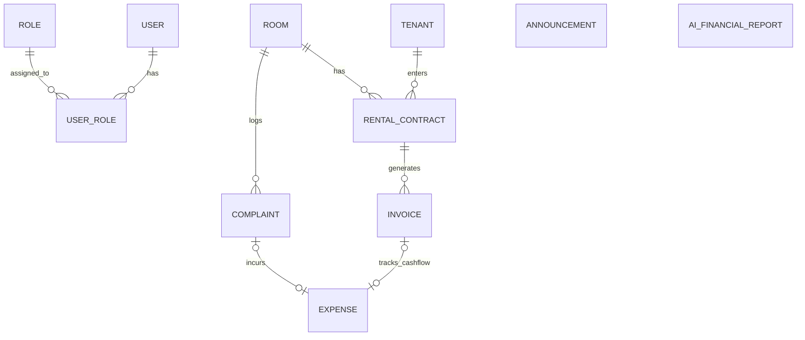

# Product Requirements Document (PRD)
## Sistem Pengelolaan Kos Bude Frisda (*HomeeKost*)

---

| Attributes | Details |
| :--- | :--- |
| **Nama Proyek** | Sistem Pengelolaan Kos Bude Frisda (*HomeeKost*) |
| **Jenis Produk** | Web Dashboard Internal (Single-Role Admin Monolith SSR) |
| **Target Penyelesaian** | 5 Minggu (Tugas Akhir PSAJ) |
| **Dokumen Status** | Approved Specifications / Ready for Sprint Execution |
| **Penulis** | Senior Product Manager & Technical Lead |
| **Versi Dokumen** | v2.0.0 (Updated: Open-WA Gateway, Docker, Multi-Role Prep, Engagement Engine) |
| **Terakhir Diperbarui**| 10 Agustus 2026 |

---

## 1. Executive Summary & Problem Statement

### 1.1 Executive Summary
**Sistem Pengelolaan Kos Bude Frisda** (*HomeeKost*) adalah aplikasi web *dashboard* internal berbasis *Monolith Server-Side Rendering* (SSR) yang dirancang khusus untuk memodernisasi dan mengotomatiskan seluruh operasional pengelolaan kos-kosan milik Bude Frisda.

Pada fase saat ini, pengembangan **difokuskan penuh (100%) untuk akses Pengelola/Admin (Pemilik Kos)**. Akses portal khusus anak kos ditunda (*postponed for future release*) tanpa menghilangkan kesiapan struktur database multi-role. 

Sistem mengotomatiskan penagihan sewa, pengiriman invoice PDF, reminder jatuh tempo, serta **Engagement Engine (Pengingat Ulang Tahun & Pengumuman Sederhana)** melalui integrasi **WhatsApp Gateway Open-Source (`open-wa`)** yang berjalan di dalam kontainer Docker terisolasi (`http://open-wa:8080`). Selain itu, sistem memanfaatkan **AI Engine (Gemini / Groq API)** untuk memproses data finansial bulanan dan menghasilkan **Laporan Keuangan Eksekutif** beserta analisis tren dan rekomendasi bisnis strategis.

### 1.2 Problem Statement
1. **Pencatatan Tercecer & Tidak Terstruktur**: Data penyewa, masa sewa, dan riwayat pembayaran disimpan dalam buku fisik atau obrolan WhatsApp terpisah.
2. **Keterlambatan Pembayaran & Kendala Manual WA**: Pemilik kos sering lupa menagih. Metode penagihan manual `wa.me/` memerlukan penekanan tombol *send* manual sehingga tidak bisa berjalan 100% otomatis di latar belakang.
3. **Pencatatan Komplain & Perbaikan yang Tak Terlacak**: Keluhan anak kos (AC rusak, kebocoran) sering terlupakan dan biaya perbaikannya tidak tercatat otomatis ke arus kas.
4. **Kurangnya Engagement Penghuni**: Tidak adanya sistem pengumuman otomatis (info kerja bakti, fasilitas) dan ucapan ulang tahun yang membangun hubungan baik pengelola dengan anak kos.
5. **Kesulitan Analisis Keuangan**: Pemilik kos kesulitan menganalisis *cash flow* bulanan dan tren profitabilitas.

### 1.3 Vision & Key Objectives
* **Automasi WhatsApp 100% via Open-WA Gateway**: Mengirimkan invoice, reminder jatuh tempo, ucapan ulang tahun, dan pengumuman secara otomatis dari server tanpa perlu interaksi klik manual.
* **Smart Financial Insight (Gemini / Groq API)**: Mengubah data finansial mentah PostgreSQL menjadi Laporan Keuangan Eksekutif PDF secara otomatis setiap tanggal 1 bulan berjalan.
* **Multi-Role Database Readiness**: Skema DB dirancang fleksibel dengan tabel `Role` terpisah untuk mempermudah integrasi portal anak kos di masa depan.
* **Infrastruktur Dockerized VPS (4GB RAM, 2 vCPU, 60GB SSD)**: Seluruh *stack* (App, PostgreSQL, dan Open-WA Docker) berjalan terorkestrasi via `docker-compose` untuk konsistensi lingkungan deployment.

---

## 2. Target Audience & Roles

### 2.1 User Profile (Fokus Utama: Admin / Pengelola)
Sistem ini menggunakan arsitektur **Single-Role Access with Multi-Role Schema Readiness**. Saat ini hanya **Admin (Bude Frisda / Pengelola)** yang memiliki akses terotentikasi ke aplikasi web.

| Parameter | Deskripsi |
| :--- | :--- |
| **Role Active** | Admin / Pemilik Kos (Bude Frisda) |
| **Perangkat Akses** | Desktop / Laptop (Utama), Tablet/Smartphone (Sekunder) |
| **Kebutuhan Utama** | Antarmuka bersih (*Sage Green & Cream*), aksi cepat (*1-Click Actions*), visualisasi status kamar, pengiriman invoice PDF otomatis, WA Gateway otomatis, pengumuman kos, dan laporan keuangan AI. |

### 2.2 System Scope & Boundaries
* ✅ **Admin Dashboard**: Akses penuh untuk pengelolaan kamar, penyewa, invoice, komplain, pengumuman, dan laporan keuangan.
* ⏸️ **Portal Anak Kos (Postponed)**: Fitur pendaftaran & login anak kos ditunda ke rilis mendatang. Database disiapkan dengan tabel `Role` terpisah (`ADMIN`, `TENANT`, `STAFF`).
* ❌ **Payment Gateway Otomatis**: Konfirmasi pembayaran dilakukan manual oleh Admin di dashboard (*Verify Paid*).

---

## 3. Tech Stack & Architecture Overview

### 3.1 Technology Stack & Infrastructure

```
+---------------------------------------------------------------------------------+
|                              VPS LINUX (4GB RAM, 2 vCPU, 60GB SSD)              |
|                                                                                 |
|  +---------------------------------------------------------------------------+  |
|  |                        DOCKER COMPOSE ORCHESTRATION                       |  |
|  |                                                                           |  |
|  |  +----------------------------------+     +----------------------------+  |  |
|  |  |  APP CONTAINER (TanStack Start)  |     |  OPEN-WA CONTAINER         |  |  |
|  |  |  - Fullstack Monolith SSR        |     |  - Node.js / Baileys       |  |  |
|  |  |  - Better-Auth (Admin Session)   |---->|  - REST API (:8080)        |  |  |
|  |  |  - Cron Scheduler (Daily/Monthly)|     |  - Webhook Listener        |  |  |
|  |  +----------------------------------+     +----------------------------+  |  |
|  |                   |                                                     |  |
|  |                   v                                                     |  |
|  |  +----------------------------------+     +----------------------------+  |  |
|  |  |  POSTGRESQL CONTAINER            |     |  GEMINI / GROQ LLM API     |  |  |
|  |  |  - Prisma ORM Adapter            |     |  - Financial Analysis API  |  |  |
|  |  +----------------------------------+     +----------------------------+  |  |
|  +---------------------------------------------------------------------------+  |
+---------------------------------------------------------------------------------+
```

| Layer | Teknologi | Alasan Pemilihan |
| :--- | :--- | :--- |
| **Framework Fullstack** | **TanStack Start + Vite** | Monolith SSR yang efisien, type-safe fullstack TypeScript, routing cepat, dan ramah memori. |
| **UI & Styling** | **React 19 + Tailwind CSS v4** | Performa tinggi, kemudahan komponen modern, dan desain earth-tone *Sage Green & Cream* (`Design.md`). |
| **Database & ORM** | **PostgreSQL + Prisma ORM** | Relational DB stabil dengan tabel `Role` terpisah dan migrasi type-safe. |
| **WA Gateway** | **Open-WA (`open-wa/wa-automate`)** | Engine WhatsApp open-source berbasis Docker yang menyediakan REST API (`POST /api/sendText`) untuk pengiriman pesan otomatis 100% tanpa klik manual. |
| **AI Integration** | **Google Gemini 1.5 / Groq API** | Memproses JSON keuangan bulanan untuk menghasilkan analisis naratif & rekomendasi bisnis. |
| **Infrastruktur** | **Docker & Docker Compose (VPS 4GB RAM)** | Memudahkan konsistensi lingkungan *development* dan *production*. |

---

## 4. Detailed Feature Breakdown

### EPIC 1: Manajemen Data Penyewa, Kamar & Engagement Engine
* **CRUD Master Kamar**: Nomor Kamar, Tipe, Harga/Bulan, Fasilitas, dan Status (`KOSONG`, `TERISI`, `PERBAIKAN`).
* **CRUD Data Penyewa**: Nama, Nomor WA (`628xxx`), No KTP, Tanggal Masuk, Tanggal Lahir (`birthDate`), Tanggal Jatuh Tempo, dan Status Sewa.
* **Engagement Engine - Pengingat Ulang Tahun**:
  * Daily Cron memindai penyewa aktif yang ulang tahun hari ini.
  * Sistem memicu Open-WA REST API untuk mengirim ucapan selamat ulang tahun otomatis:
    > *"Selamat Ulang Tahun Kak [Nama Penyewa]! 🥳 Semoga panjang umur, sehat selalu, dan semakin sukses. Salam hangat dari pengelola Kos Bude Frisda! 🎂"*
* **Engagement Engine - Pengumuman Sederhana**:
  * Admin dapat membuat pengumuman (info kerja bakti, perbaikan air/listrik, acara kos).
  * Opsi tombol **Broadcast via Open-WA** ke seluruh nomor WhatsApp penyewa aktif.

### EPIC 2: Invoice Digital Engine & Open-WA Dispatcher
* **Generator Invoice PDF**: Auto-generate penomoran invoice (`INV/YYYYMM/XXXX`) & render dokumen PDF.
* **Automated & 1-Click WA Dispatch**:
  * **Automated Dispatch**: System memanggil API Open-WA `POST http://open-wa:8080/api/sendText` untuk mengirimkan pesan & link invoice otomatis.
  * **1-Click WA Redirect Fallback**: Tombol manual `wa.me/` tetap disajikan di UI sebagai opsi cadangan.

### EPIC 3: Reminder Pembayaran Otomatis (Cron Job & Open-WA API)
* **Daily Cron Job (08:00 WIB)**:
  * Mengecek due dates (H-3, H-0, H+1 Overdue).
  * Auto-update status tagihan menjadi `OVERDUE`.
  * Mengirim pesan peringatan otomatis via Open-WA API ke WhatsApp penyewa.
  * Memperbarui widget Dashboard **"Perlu Ditagih Hari Ini"**.

### EPIC 4: Pencatatan Komplain & Perbaikan Kamar
* **Log Keluhan Anak Kos**: Form input manual oleh Admin (Nomor Kamar, Kategori, Deskripsi, Status: `PENDING`, `IN_PROGRESS`, `DONE`).
* **Integrasi Biaya Perbaikan**: Mengubah status menjadi `DONE` secara otomatis menyatutkan biaya perbaikan ke tabel `Expense` (Pengeluaran).

### EPIC 5: Laporan Keuangan Eksekutif & Monthly AI Insight
* **Pencatatan Arus Kas**: Pemasukan sewa & pengeluaran operasional.
* **Monthly Cron Job (Tanggal 1 Jam 00:01 WIB)**:
  * Agregasi data PostgreSQL -> Payload JSON -> Gemini / Groq API.
  * Parsing respon naratif JSON (Summary, Trend, Risk, Recommendation).
  * Render PDF **Laporan Keuangan Eksekutif Bulanan** & tampilkan Card AI Insight (`.ai-insight-box`) di dashboard.

---

## 5. High-Level Database Schema (PostgreSQL / Prisma)

Skema database disiapkan untuk fleksibilitas multi-role di masa mendatang melalui pemisahan tabel `Role`:



### Table Definitions Brief:
1. **`Role`**: `id` (PK), `name` (`ADMIN`, `TENANT`, `STAFF`), `description`.
2. **`User`**: `id` (PK), `email`, `passwordHash`, `name`, `createdAt`.
3. **`UserRole`**: `userId` (FK), `roleId` (FK).
4. **`Room`**: `id` (PK), `roomNumber`, `type`, `monthlyPrice`, `facilities`, `status` (`VACANT`, `OCCUPIED`, `MAINTENANCE`).
5. **`Tenant`**: `id` (PK), `name`, `whatsappNumber`, `identityCardNumber`, `birthDate` (DateTime, Nullable), `status` (`ACTIVE`, `INACTIVE`), `createdAt`.
6. **`RentalContract`**: `id` (PK), `tenantId` (FK), `roomId` (FK), `startDate`, `dueDateDay`, `status` (`ACTIVE`, `TERMINATED`).
7. **`Invoice`**: `id` (PK), `invoiceNumber`, `contractId`, `periodMonth`, `periodYear`, `amount`, `dueDate`, `status` (`PENDING`, `PAID`, `OVERDUE`, `CANCELLED`), `paidAt`, `pdfUrl`.
8. **`Complaint`**: `id` (PK), `roomId` (FK), `category`, `description`, `status` (`PENDING`, `IN_PROGRESS`, `DONE`), `reportedDate`, `resolvedDate`.
9. **`Expense`**: `id` (PK), `category`, `amount`, `description`, `transactionDate`, `complaintId` (FK, Nullable).
10. **`Announcement`**: `id` (PK), `title`, `content`, `category`, `createdAt`, `sentAt` (Nullable), `isBroadcast` (Boolean).
11. **`AiFinancialReport`**: `id` (PK), `periodMonth`, `periodYear`, `totalIncome`, `totalExpense`, `netProfit`, `occupancyRate`, `aiNarrativeSummary` (JSON), `pdfFileUrl`, `createdAt`.

---

## 6. Docker & Infrastructure Plan (VPS 4GB RAM)

### `docker-compose.yml` Structure Overview:
```yaml
version: '3.8'
services:
  app:
    build: .
    ports:
      - "3000:3000"
    environment:
      - DATABASE_URL=postgresql://postgres:secret@db:5432/homeekost
      - OPEN_WA_API_URL=http://open-wa:8080
      - OPEN_WA_API_KEY=${OPEN_WA_API_KEY}
      - GEMINI_API_KEY=${GEMINI_API_KEY}
    depends_on:
      - db
      - open-wa

  db:
    image: postgres:16-alpine
    environment:
      - POSTGRES_DB=homeekost
      - POSTGRES_USER=postgres
      - POSTGRES_PASSWORD=secret
    volumes:
      - pgdata:/var/lib/postgresql/data

  open-wa:
    image: openwa/wa-automate:latest
    ports:
      - "8080:8080"
    environment:
      - API_KEY=${OPEN_WA_API_KEY}
    volumes:
      - wa_session:/app/session

volumes:
  pgdata:
  wa_session:
```

---

## 7. Penutup

PRD v2.0.0 ini memadukan kemudahan pengelolaan internal kos Bude Frisda dengan otomatisasi penuh via **Open-WA Docker Gateway**, dukungan analisis keuangan AI, fitur engagement penghuni (ulang tahun & pengumuman), serta kesiapan arsitektur multi-role berbasis Docker pada VPS Linux 4GB RAM.
