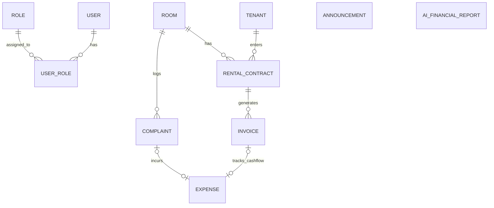

# Product Requirements Document (PRD)
## Sistem Pengelolaan Kos Bude Frisda (*HomeeKost*)

---

| Attributes | Details |
| :--- | :--- |
| **Nama Proyek** | Sistem Pengelolaan Kos Bude Frisda (*HomeeKost*) |
| **Jenis Produk** | Web Dashboard Internal (Single-Role Admin Monolith SSR) |
| **Target Penyelesaian** | 5 Minggu (Tugas Akhir PSAJ) |
| **Dokumen Status** | Approved Specifications / Ready for Sprint Execution |
| **Penulis** | Senior Product Manager & Technical Lead |
| **Versi Dokumen** | v2.1.0 (Updated: OpenWA `rmyndharis/OpenWA` Gateway Port 2785, Docker Compose) |
| **Terakhir Diperbarui**| 10 Agustus 2026 |

---

## 1. Executive Summary & Problem Statement

### 1.1 Executive Summary
**Sistem Pengelolaan Kos Bude Frisda** (*HomeeKost*) adalah aplikasi web *dashboard* internal berbasis *Monolith Server-Side Rendering* (SSR) yang dirancang khusus untuk memodernisasi dan mengotomatiskan seluruh operasional pengelolaan kos-kosan milik Bude Frisda.

Pada fase saat ini, pengembangan **difokuskan penuh (100%) untuk akses Pengelola/Admin (Pemilik Kos)**. Akses portal khusus anak kos ditunda (*postponed for future release*) tanpa menghilangkan kesiapan struktur database multi-role.

Sistem mengotomatiskan penagihan sewa, pengiriman invoice PDF, reminder jatuh tempo, serta **Engagement Engine (Pengingat Ulang Tahun & Pengumuman Sederhana)** melalui integrasi **WhatsApp Gateway OpenWA (`rmyndharis/OpenWA`)** yang berjalan di dalam kontainer Docker terisolasi (`http://open-wa:2785/api`). Selain itu, sistem memanfaatkan **AI Engine (Gemini / Groq API)** untuk memproses data finansial bulanan dan menghasilkan **Laporan Keuangan Eksekutif** beserta analisis tren dan rekomendasi bisnis strategis.

### 1.2 Vision & Key Objectives
* **Automasi WhatsApp 100% via OpenWA Gateway (`rmyndharis/OpenWA`)**: Mengirimkan invoice, reminder jatuh tempo, ucapan ulang tahun, dan pengumuman secara otomatis via REST API (`POST /api/sessions/{sessionId}/messages/send-text`) tanpa klik manual.
* **OpenWA Embedded Web Dashboard**: Menyediakan dashboard bawaan OpenWA pada port `2785` untuk pemindaian QR Code dan pengelolaan sesi WhatsApp.
* **Smart Financial Insight (Gemini / Groq API)**: Mengubah data finansial mentah PostgreSQL menjadi Laporan Keuangan Eksekutif PDF secara otomatis setiap tanggal 1 bulan berjalan.
* **Multi-Role Database Readiness**: Skema DB dirancang fleksibel dengan tabel `Role` terpisah untuk mempermudah integrasi portal anak kos di masa depan.
* **Infrastruktur Dockerized VPS (4GB RAM, 2 vCPU, 60GB SSD)**: Seluruh *stack* (App, PostgreSQL, dan OpenWA Docker) berjalan terorkestrasi via `docker-compose` di root.

---

## 2. Target Audience & Roles

### 2.1 User Profile (Fokus Utama: Admin / Pengelola)
Sistem ini menggunakan arsitektur **Single-Role Access with Multi-Role Schema Readiness**. Saat ini hanya **Admin (Bude Frisda / Pengelola)** yang memiliki akses terotentikasi ke aplikasi web.

| Parameter | Deskripsi |
| :--- | :--- |
| **Role Active** | Admin / Pemilik Kos (Bude Frisda) |
| **Perangkat Akses** | Desktop / Laptop (Utama), Tablet/Smartphone (Sekunder) |
| **Kebutuhan Utama** | Antarmuka bersih (*Sage Green & Cream*), aksi cepat (*1-Click Actions*), visualisasi status kamar, pengiriman invoice PDF otomatis, WA Gateway otomatis, pengumuman kos, dan laporan keuangan AI. |

---

## 3. Tech Stack & Architecture Overview

### 3.1 Technology Stack & Infrastructure

```
+---------------------------------------------------------------------------------+
|                              VPS LINUX (4GB RAM, 2 vCPU, 60GB SSD)              |
|                                                                                 |
|  +---------------------------------------------------------------------------+  |
|  |                        DOCKER COMPOSE ORCHESTRATION                       |  |
|  |                                                                           |  |
|  |  +----------------------------------+     +----------------------------+  |  |
|  |  |  APP CONTAINER (TanStack Start)  |     |  OPENWA CONTAINER          |  |  |
|  |  |  - Fullstack Monolith SSR        |     |  - NestJS 11 + Dashboard   |  |  |
|  |  |  - Better-Auth (Admin Session)   |---->|  - REST API (:2785/api)    |  |  |
|  |  |  - Cron Scheduler (Daily/Monthly)|     |  - Webhook Listener        |  |  |
|  |  +----------------------------------+     +----------------------------+  |  |
|  |                   |                                                     |  |
|  |                   v                                                     |  |
|  |  +----------------------------------+     +----------------------------+  |  |
|  |  |  POSTGRESQL CONTAINER            |     |  GEMINI / GROQ LLM API     |  |  |
|  |  |  - Prisma ORM Adapter            |     |  - Financial Analysis API  |  |  |
|  |  +----------------------------------+     +----------------------------+  |  |
|  +---------------------------------------------------------------------------+  |
+---------------------------------------------------------------------------------+
```

| Layer | Teknologi | Alasan Pemilihan |
| :--- | :--- | :--- |
| **Framework Fullstack** | **TanStack Start + Vite** | Monolith SSR yang efisien, type-safe fullstack TypeScript, routing cepat, dan ramah memori. |
| **UI & Styling** | **React 19 + Tailwind CSS v4** | Performa tinggi, kemudahan komponen modern, dan desain earth-tone *Sage Green & Cream* (`Design.md`). |
| **Database & ORM** | **PostgreSQL + Prisma ORM** | Relational DB stabil dengan tabel `Role` terpisah dan migrasi type-safe. |
| **WA Gateway** | **OpenWA (`ghcr.io/rmyndharis/openwa`)** | WhatsApp Gateway NestJS 11.x berbasis Docker yang menyediakan REST API (`:2785/api`) & Dashboard bawaan untuk pengiriman pesan otomatis 100%. |
| **AI Integration** | **Google Gemini 1.5 / Groq API** | Memproses JSON keuangan bulanan untuk menghasilkan analisis naratif & rekomendasi bisnis. |
| **Infrastruktur** | **Docker & Docker Compose (VPS 4GB RAM)** | Memudahkan konsistensi lingkungan *development* dan *production*. |

---

## 4. Detailed OpenWA REST API Endpoints

Aplikasi `app` (HomeeKost) akan berkomunikasi dengan kontainer `open-wa` (`http://open-wa:2785/api`) melalui HTTP client ter-autentikasi (`X-API-Key`):

1. **Check Session Health / Status**:
   `GET http://open-wa:2785/api/sessions/{sessionId}`
2. **Start Session & Get QR Code**:
   * `POST http://open-wa:2785/api/sessions/{sessionId}/start`
   * `GET http://open-wa:2785/api/sessions/{sessionId}/qr`
3. **Send Automated Text Message**:
   `POST http://open-wa:2785/api/sessions/{sessionId}/messages/send-text`
   * **Header**: `X-API-Key: <OPEN_WA_API_KEY>`
   * **Payload**:
     ```json
     {
       "chatId": "628123456789@c.us",
       "text": "Halo Kak Budi, berikut invoice sewa kos Kamar A-101..."
     }
     ```
4. **Register Webhooks**:
   `POST http://open-wa:2785/api/sessions/{sessionId}/webhooks`

---

## 5. High-Level Database Schema (PostgreSQL / Prisma)



---

## 6. Docker & Infrastructure Plan (VPS 4GB RAM)

### `docker-compose.yml` Structure:
```yaml
version: '3.8'

services:
  app:
    build:
      context: .
      dockerfile: Dockerfile
    container_name: homeekost_app
    ports:
      - "3000:3000"
    environment:
      - DATABASE_URL=postgresql://postgres:secret@db:5432/homeekost?schema=public
      - OPEN_WA_API_URL=http://open-wa:2785/api
      - OPEN_WA_API_KEY=${OPEN_WA_API_KEY}
      - OPEN_WA_SESSION_ID=homeekost-session
    depends_on:
      db:
        condition: service_healthy
      open-wa:
        condition: service_started

  db:
    image: postgres:16-alpine
    container_name: homeekost_db
    ports:
      - "5432:5432"

  open-wa:
    image: ghcr.io/rmyndharis/openwa:latest
    container_name: homeekost_openwa
    ports:
      - "2785:2785"
    environment:
      - PORT=2785
      - API_KEY=${OPEN_WA_API_KEY}
    volumes:
      - openwa_data:/app/data

volumes:
  pgdata:
  openwa_data:
```

---

## 7. Penutup

PRD v2.1.0 menyelaraskan arsitektur gateway WhatsApp menggunakan **OpenWA (`rmyndharis/OpenWA`)** port `2785` yang memiliki REST API mandiri dan web dashboard bawaan untuk pemindaian QR Code, berjalan terorkestrasi via Docker Compose di root project.
