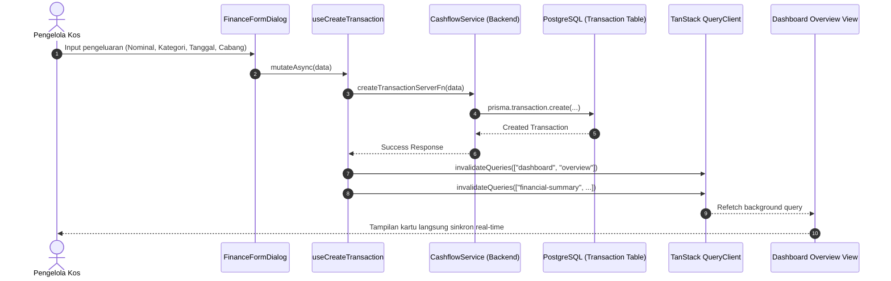

# Spesifikasi Desain: Sinkronisasi Riwayat & Perhitungan Pengeluaran Kas (HomeeKost)

## 1. Ringkasan Eksekutif & Latar Belakang

Pada modul Keuangan dan Dashboard HomeeKost, ditemukan ketidaksesuaian persepsi dan data antara transaksi pengeluaran yang diinput oleh pengelola kos dengan angka ringkasan yang ditampilkan di layar (*"pengeluaran tertera Rp 1,1 jt padahal riilnya sudah lebih dari angka tersebut"*).

Setelah dilakukan audit kode, ditemukan 4 akar penyebab teknis:
1. **Cache React Query Tidak Ter-invalidate**: Mutasi penambahan/pengubahan transaksi (`useCreateTransaction`, `useUpdateTransaction`, `useDeleteTransaction`) tidak meng-invalidate query key `["dashboard", "overview"]`, sehingga halaman Dashboard utama tetap menampilkan data cache lama (*stale*) sebelum transaksi baru ditambahkan hingga browser di-reload secara manual.
2. **Pemotongan Format Angka di Dashboard**: Fungsi `formatJuta` di `dashboard.service.ts` memotong angka ke 1 desimal (`maximumFractionDigits: 1`), sehingga nominal seperti Rp 1.140.000 atau Rp 1.180.000 ditampilkan sebagai `Rp1,1 jt`, menyebabkan klien merasa nominal pengeluarannya hilang atau dipotong.
3. **Inkonsistensi Filter Periode Tabel vs Kartu KPI**: Di halaman `/dashboard/finance`, kartu ringkasan atas menghitung pengeluaran berdasarkan bulan & tahun terpilih, sedangkan tabel riwayat transaksi di bawah menampilkan seluruh transaksi dari semua bulan (*all-time*), sehingga daftar transaksi di tabel tidak cocok dengan total kartu atas.
4. **Pergeseran Batas Waktu Bulan (Timezone UTC vs WIB)**: Penggunaan `new Date().toISOString()` pada input tanggal dan ketidakkonsistenan batas waktu `startOfMonth`/`endOfMonth` antara UTC dan waktu lokal server dapat menggeser transaksi awal/akhir bulan ke bulan sebelum atau sesudahnya.

Desain ini menetapkan standarisasi menyeluruh untuk menyelesaikan keempat masalah di atas secara tuntas.

---

## 2. Arsitektur & Alur Data

### 2.1 Alur Mutasi Transaksi & Invalidasi Cache
Ketika pengguna membuat, mengubah, atau menghapus transaksi kas:
1. Pengguna mengirimkan form di `FinanceFormDialog`.
2. Server Function `createTransactionServerFn` mengeksekusi `CashflowService.createTransaction`.
3. Database PostgreSQL mencatat baris baru pada tabel `transactions`.
4. Pada callback `onSuccess` di sisi client (`use-transactions.ts`), Query Client secara reaktif meng-invalidate seluruh query terkait:
   - `TRANSACTIONS_QUERY_KEY` (`["transactions"]`)
   - `FINANCIAL_SUMMARY_QUERY_KEY` (`["financial-summary"]`)
   - `COST_COMPOSITION_QUERY_KEY` (`["cost-composition"]`)
   - `MONTHLY_TRENDS_QUERY_KEY` (`["monthly-trends"]`)
   - `PROFIT_LOSS_QUERY_KEY` (`["profit-loss"]`)
   - `ANNUAL_MATRIX_QUERY_KEY` (`["annual-matrix"]`)
   - `DASHBOARD_CONTEXT_QUERY_KEY` (`["dashboard-context"]`)
   - **TAMBAHAN BARU**: `["dashboard", "overview"]` dan `["dashboard-overview"]`
5. Ketika pengguna membuka kembali `/dashboard`, data ringkasan (`monthlyExpense`) sudah ter-update secara otomatis tanpa reload browser.

---

## 3. Komponen & Spesifikasi Antarmuka (UI/UX)

### 3.1 Transparansi Nominal Kartu Dashboard (`/dashboard`)
* **File Terkait:** `src/data/services/dashboard.service.ts` & `src/routes/dashboard/index.tsx`
* **Logika Format:**
  * Di `dashboard.service.ts`, `stats` mengembalikan:
    - `monthlyExpense`: String ringkas berformat Rupiah presisi (misal: jika `< 10 juta`, tampilkan `formatRupiah(val)` utuh seperti `Rp1.140.000`; jika `≥ 10 juta`, tampilkan `RpXX,X jt` dengan subteks nominal riil).
    - `monthlyExpenseRaw`: Nominal numerik asli (`number`).
  * Di `src/routes/dashboard/index.tsx`:
    - Kartu **Pengeluaran Bulan Ini** menampilkan nominal utama yang jelas.
    - Subteks kartu menampilkan informasi periode dan nominal presisi bila format ringkas digunakan, sehingga tidak ada angka yang terkesan "hilang".

### 3.2 Sinkronisasi Filter Periode Tabel Transaksi Kas (`/dashboard/finance`)
* **File Terkait:** `src/routes/dashboard/finance.tsx` & `src/components/finance/FinanceTransactionTable.tsx`
* **Spesifikasi:**
  * Menghubungkan state `selectedMonth.value` dan `selectedYear.value` ke hook `useTransactions`.
  * Menghitung parameter `startDate` dan `endDate` berbasis bulan & tahun aktif untuk dikirim ke API/Server Function transaksi.
  * Menyediakan toggle/filter opsi pada toolbar tabel:
    - **"Bulan Terpilih"** (Default: memfilter transaksi sesuai dropdown Bulan & Tahun di atas).
    - **"Semua Periode"** (Menampilkan riwayat keseluruhan jika ingin melihat riwayat lampau).
  * Menampilkan badge indikator periode aktif di atas tabel: misal *"Menampilkan transaksi: Oktober 2026"*.

---

## 4. Standarisasi Tanggal & Zona Waktu (WIB UTC+7)

### 4.1 Logika Perhitungan Rentang Bulan
* **File Terkait:** `src/lib/date-utils.ts`, `src/data/services/cashflow.service.ts`, `src/data/services/dashboard.service.ts`, `src/data/repositories/report.repository.ts`
* **Spesifikasi:**
  * Buat utility terpusat `getMonthDateRange(month: number, year: number)` di `src/lib/date-utils.ts`:
    - Menghitung batas awal: tanggal 1 jam `00:00:00.000` waktu WIB (ekuivalen dengan jam `17:00:00.000` UTC hari terakhir bulan sebelumnya).
    - Menghitung batas akhir: tanggal terakhir jam `23:59:59.999` waktu WIB (ekuivalen dengan jam `16:59:59.999` UTC tanggal terakhir bulan berjalan).
  * Perbaiki fungsi `getTodayDateString()`:
    - Menggunakan waktu lokal Indonesia (WIB UTC+7) bukan `new Date().toISOString()` UTC agar transaksi yang diinput antara jam `00:00` hingga `06:59` WIB tidak mundur ke hari kemarin.

---

## 5. Penanganan Error & Kasus Khusus (Edge Cases)

| Skenario Edge Case | Potensi Masalah | Solusi Penanganan |
| :--- | :--- | :--- |
| **Transaksi Antar-Bulan** | Pengguna mencatat transaksi untuk bulan lalu dari menu bulan ini. | Jika filter tabel disetel ke "Bulan Terpilih", berikan notifikasi toast informatif: *"Transaksi berhasil dicatat pada periode [Bulan Terkait]"*, atau arahkan filter ke bulan tersebut. |
| **Pengeluaran Multi-Cabang** | SuperAdmin menginput pengeluaran saat filter "Semua Cabang" aktif. | Form dialog mewajibkan pemilihan cabang kos secara eksplisit agar `propertyId` tidak bernilai null atau salah sasaran. |
| **Pembulatan Nominal** | Angka pengeluaran memiliki pecahan ribuan (misal: Rp 1.125.000). | Format angka tidak membulatkan ke jutaan jika masih dalam rentang satuan kecil, melainkan menyajikan nominal rupiah lengkap. |

---

## 6. Rencana Pengujian & Verifikasi

Sesuai dengan ketentuan `AGENTS.md`:
* **Pengujian Unit Murni (Automated Unit Tests)**:
  - Unit test fungsi `getMonthDateRange` untuk verifikasi rentang tanggal awal dan akhir bulan tepat di zona WIB.
  - Unit test fungsi `getTodayDateString` untuk memastikan jam 01:00 WIB tidak menghasilkan tanggal H-1.
  - Unit test pemformatan mata uang dan nilai ringkas.
* **Static Analysis**:
  - `npm run check` (Biome linting & formatting).
  - `npx tsc --noEmit` (TypeScript type check).
* **Verifikasi Operasional**:
  - Dilakukan secara manual oleh User/Penguji melalui dashboard web.
