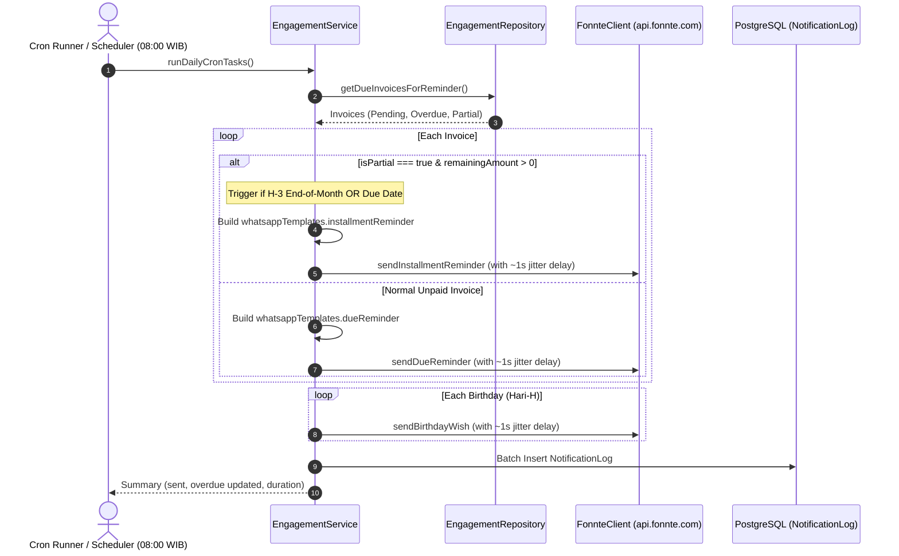

# Technical Specification: Tenant Natural Sorting, WhatsApp Pacing & Installment Cron Automation

- **Target System**: HomeeKost Management Platform
- **Date**: 2026-10-12
- **Status**: Approved by User
- **Scope**:
  1. Natural Alphanumeric Sorting & Interactive Table Sorting on `/dashboard/tenants`
  2. WhatsApp Pacing Delay (Human-like Jitter / Anti-Ban) in Loop Senders
  3. Automated Daily Cron for Installment Reminders (`runDailyCronTasks`) & UI Action Alignment

---

## 1. Problem Statement & Motivation

1. **Tenant Table Order Ambiguity**:
   On `/dashboard/tenants`, tenants were ordered by database creation or tenant name without any explicit sorting for room numbers. Room numbers with mixed numeric or zero-padded schemes (e.g. `01`, `02`, `10`, `A-1`, `A-10`) either sorted as raw ASCII or were arbitrary, making it difficult for property managers to scan rooms sequentially. Additionally, table column headers lacked interactive sorting buttons.

2. **WhatsApp Bot / Spam Risk During Batch Sending**:
   When dispatching notifications via Fonnte in loops (daily reminders, birthday wishes, or broadcast announcements), promises were resolved back-to-back without delays. Meta's anti-spam algorithms detect burst message dispatch as bot activity, risking WhatsApp gateway disconnection or number bans.

3. **Installment Reminders Not Handled in Daily Cron**:
   Currently, partially paid invoices (`isPartial`) are recorded with a master invoice, and manual reminder links exist in the Payments UI. However, the daily background cron (`runDailyCronTasks`) treats all unpaid invoices identically by sending the standard `dueReminder` with full amounts, rather than recognizing partial payments and sending the transparent `installmentReminder` (showing Total, Sudah Dibayar, Sisa Pelunasan, and End of Month deadline) at the appropriate schedule (H-3 before the end of the month).

---

## 2. Functional & Technical Requirements

### 2.1 Natural Alphanumeric Sorting on `/dashboard/tenants`
- **Default Sort**: `roomNo` ascending (`asc`).
- **Natural Alphanumeric Algorithm**:
  Use `Intl.Collator` or `String.prototype.localeCompare` with `{ numeric: true, sensitivity: "base" }`:
  - Numbers: `01` < `02` < `03` < `10` < `11`
  - Letters: `A` < `B` < `C`
  - Combinations: `A-01` < `A-02` < `A-10` < `B-01`, `Kamar 1` < `Kamar 2` < `Kamar 10`
- **Interactive Column Headers**:
  Allow clicking on headers with sorting indicators (`ArrowUp` for asc, `ArrowDown` for desc, `ArrowDownUp` for inactive):
  - `roomNo` (Kamar)
  - `name` (Penghuni)
  - `startDate` (Mulai Sewa)
  - `dueDate` (Jatuh Tempo)
  - `paymentStatus` (Status Pembayaran: Lancar / Terlambat)
- **UI Aesthetic**:
  Strictly adhere to HomeeKost Sage Green & Cream tokens (`DESIGN.md`).

### 2.2 WhatsApp Pacing & Anti-Ban Delay (`sleepWithJitter`)
- **Pacing Engine**:
  Create an asynchronous sleep utility with random jitter:
  ```ts
  export async function sleepWithJitter(
    baseMs: number = 900,
    jitterMs: number = 400,
  ): Promise<void> {
    const delay = baseMs + Math.floor(Math.random() * jitterMs);
    await new Promise((resolve) => setTimeout(resolve, delay));
  }
  ```
- **Application**:
  Insert `await sleepWithJitter(800, 400)` (yields ~800ms - 1200ms per recipient) between loop iterations in:
  - `engagement.service.ts`: `runDailyCronTasks()` (due reminders, installment reminders, birthday wishes)
  - `engagement.service.ts`: `broadcastAnnouncement()` (mass broadcasts)

### 2.3 Automated Daily Cron for Installment Reminders
- **Cron Engine Enhancement (`runDailyCronTasks`)**:
  - In `getDueInvoicesForReminder()` or within `runDailyCronTasks()`, inspect invoices with active contracts.
  - Calculate `installmentSummary = calculateInstallmentSummary(amount, transactions)`.
  - If `installmentSummary.isPartial` and `installmentSummary.remainingAmount > 0`:
    - **Trigger Condition A (End-of-Month H-3)**: Check if current date is 3 days before the end of the month (e.g. Day 28 on a 31-day month, Day 27 on a 30-day month, Day 25/26 on Feb).
    - **Trigger Condition B (Due Date)**: If today matches H-3 or H-0 of the invoice's due date.
    - Format message using `whatsappTemplates.installmentReminder(...)`:
      - `totalAmount`: invoice full amount
      - `totalPaid`: sum of paid transactions
      - `remainingAmount`: sisa pelunasan
      - `endOfMonthDate`: formatted end of month string (e.g. `31 Oktober 2026`)
    - Dispatch via `this.fonnte.sendInstallmentReminder` or `this.fonnte.sendText`.
    - Record audit log to `NotificationLog` as `messageType: "DUE_DATE_REMINDER"` with note `Cron Pengingat Sisa Cicilan (#INV)`.
- **Payment Page Alignment (`/dashboard/payments`)**:
  - In `handleSendWhatsApp`, ensure that if `payment.isPartial` is true, the mutation passes `type: "REMINDER"`, so it triggers `sendInstallmentReminder` instead of falling back to `NEW_INVOICE`.

---

## 3. Architecture & Data Flow



---

## 4. Verification & Testing Strategy

1. **Pure Unit Testing**:
   - `src/lib/sort-utils.test.ts`:
     - Test `naturalCompare`:
       - Numeric: `["02", "01", "10"]` -> `["01", "02", "10"]`
       - Alphabetical: `["B", "A", "C"]` -> `["A", "B", "C"]`
       - Alphanumeric mixed: `["A-10", "A-2", "A-1", "B-1"]` -> `["A-1", "A-2", "A-10", "B-1"]`
       - Natural room numbers: `["Kamar 10", "Kamar 2", "Kamar 1"]` -> `["Kamar 1", "Kamar 2", "Kamar 10"]`
   - `src/lib/date-utils.test.ts`:
     - Verify end-of-month H-3 calculation helper.
2. **Static Analysis & Linting**:
   - `npx tsc --noEmit`: 0 TypeScript errors.
   - `npm run check`: 0 Biome linting/formatting errors.
3. **Manual User Verification**:
   - Verify room sorting on `/dashboard/tenants`.
   - Verify clicking sorting columns on `/dashboard/tenants`.
   - Verify clicking "Jalankan Cron Pagi" on `/dashboard/engagement` logs installment reminder and executes with human-like delay.
