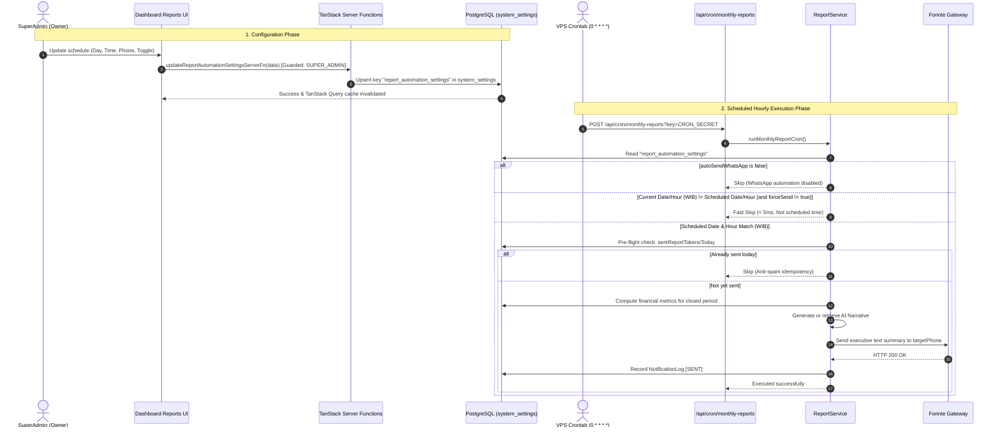

# Technical Specification: SuperAdmin Dynamic Report Automation Scheduler & System Settings

**Date:** 2026-10-21  
**Author:** Antigravity AI  
**Status:** Approved  
**Scope:** Backend Cron Scheduler, PostgreSQL System Settings Persistence, SuperAdmin RBAC Guard, and Dynamic Reports UI.

---

## 1. Problem Statement & Motivation

HomeeKost provides an Executive Monthly Financial Report (`/dashboard/reports`) with AI-generated business insights (powered by Google Gemini) and automated WhatsApp summaries. 

Previously:
1. In the Web UI (`/dashboard/reports`), the modal dialog for setting the automation schedule (`scheduleDay`, `scheduleTime`, `autoSendWhatsApp`, `targetPhone`) was only stored in the user's browser `localStorage` (`AUTOMATION_STORAGE_KEY`).
2. The server background cron endpoint (`/api/cron/monthly-reports`) had no access to these browser-stored settings and executed immediately whenever triggered, without verifying whether the current day and hour matched the manager's intended schedule.
3. The automation card and configuration modal were visible to all staff, whereas only the Kos Owner (`SUPER_ADMIN`) should control executive reporting schedules and configure the target WhatsApp number.

This specification establishes an end-to-end persistent architecture:
- Stores system configurations in a generic, durable `system_settings` PostgreSQL table.
- Enforces strict `SUPER_ADMIN` RBAC for modifying report schedules.
- Enables an hourly background cron runner (`0 * * * *`) that checks current Western Indonesian Time (WIB, UTC+7) against the database schedule, executing only when scheduled (or when forced via `?forceSend=true`).

---

## 2. Architecture & Data Flow



---

## 3. Detailed Component Specifications

### 3.1 Database Schema (`fullstack/prisma/schema.prisma`)

Add the generic `SystemSetting` model:

```prisma
model SystemSetting {
  id        String   @id @default(cuid())
  key       String   @unique
  value     String   @db.Text
  createdAt DateTime @default(now())
  updatedAt DateTime @updatedAt

  @@map("system_settings")
}
```

- Key: `"report_automation_settings"`
- Value: JSON string matching `AutomationSettingsFormValues`:
  ```json
  {
    "scheduleDay": 1,
    "scheduleTime": "08:00",
    "autoSendWhatsApp": true,
    "targetPhone": "081234567890",
    "aiModel": "gemini-3.5-flash-lite"
  }
  ```

### 3.2 System Setting Repository (`src/data/repositories/system-setting.repository.ts`)
- `getSetting<T>(key: string): Promise<T | null>`:
  Deserializes JSON value from `system_settings`.
- `setSetting<T>(key: string, value: T): Promise<void>`:
  Serializes value to JSON and upserts by `key`.

### 3.3 Report Service Enhancements (`src/data/services/report.service.ts`)
1. **`getAutomationSettings()`**:
   - Fetches from `system_settings` key `"report_automation_settings"`.
   - Returns defaults if not found:
     ```ts
     {
       scheduleDay: 1,
       scheduleTime: "08:00",
       autoSendWhatsApp: false,
       targetPhone: "",
       aiModel: "gemini-3.5-flash-lite"
     }
     ```
2. **`updateAutomationSettings(values, user)`**:
   - RBAC check: verifies `user.role?.name === "SUPER_ADMIN"`. Throws `ForbiddenError` if role is `ADMIN`.
   - Validates values with `automationSettingsSchema`.
   - Saves to `systemSettingRepository`.
3. **`runMonthlyReportCron(options)` Time Matching Logic**:
   - If `options.forceSend === true`, bypass schedule validation.
   - Read automation settings from DB.
   - If `settings.autoSendWhatsApp === false` and `options.sendWhatsApp !== true`:
     Return `{ skipped: true, reason: "Automasi WhatsApp dinonaktifkan di pengaturan sistem" }`.
   - Determine current time in Western Indonesian Time (WIB / UTC+7):
     ```ts
     const nowWib = new Date(Date.now() + 7 * 60 * 60 * 1000);
     const currentDay = nowWib.getUTCDate();
     const currentHour = nowWib.getUTCHours();
     const [schedHourStr] = (settings.scheduleTime || "08:00").split(":");
     const scheduledHour = Number.parseInt(schedHourStr, 10);
     ```
   - If `currentDay !== settings.scheduleDay || currentHour !== scheduledHour`:
     Return `{ skipped: true, reason: `Bukan jadwal eksekusi (Jadwal: tgl ${settings.scheduleDay} jam ${settings.scheduleTime} WIB, Sekarang: tgl ${currentDay} jam ${currentHour}:00 WIB)` }`.
   - Effective target phone: `options.targetPhone || settings.targetPhone`.

### 3.4 Server Functions & Hooks
- `src/data/servers/report.fn.ts`:
  - `getReportAutomationSettingsServerFn`: reads active settings.
  - `updateReportAutomationSettingsServerFn`: validates input and saves settings, guarded by session and `SUPER_ADMIN` check.
- `src/hooks/use-reports.ts`:
  - `useReportAutomationSettings()`: TanStack Query hook with queryKey `["reports", "automation-settings"]`.
  - `useUpdateReportAutomationSettings()`: TanStack Mutation hook that invalidates `["reports", "automation-settings"]`.

### 3.5 UI Component & RBAC (`src/routes/dashboard/reports.tsx`)
- Load settings via `useReportAutomationSettings()`.
- Wrap `<ReportAutomationCard>` and `<AutomationSettingsDialog>` with `isSuperAdmin`:
  ```tsx
  {isSuperAdmin && (
    <>
      <ReportAutomationCard
        scheduleDay={automationSettings.scheduleDay}
        scheduleTime={automationSettings.scheduleTime}
        onOpenSettings={() => setIsSettingsOpen(true)}
      />
      <AutomationSettingsDialog
        open={isSettingsOpen}
        onOpenChange={setIsSettingsOpen}
        initialValues={automationSettings}
        onSubmit={handleSaveAutomationSettings}
      />
    </>
  )}
  ```
- Submitting saves via `updateReportAutomationSettingsMutation.mutateAsync(values)` with toast notifications.
- Remove legacy `localStorage` write/read for automation settings.

### 3.6 VPS Crontab Alignment
In the VPS production environment (`/var/www/homeekost`):
```bash
# 1. Daily tasks (tagihan, overdue, ultah) - Setiap hari jam 08:00 WIB (01:00 UTC)
0 1 * * * curl -s -X POST "http://localhost:3000/api/cron/daily-tasks?key=homeekost-daily-cron-secret" >> /var/log/homeekost-daily-cron.log 2>&1

# 2. Hourly report runner - Setiap jam (backend yang mengecek jadwal tanggal & jam WIB dari database)
0 * * * * curl -s -X POST "http://localhost:3000/api/cron/monthly-reports?key=homeekost-daily-cron-secret" >> /var/log/homeekost-monthly-cron.log 2>&1
```

---

## 4. Security & Compliance (AGENTS.md)
1. **RBAC Isolation**: Only authenticated `SUPER_ADMIN` can view the card, dialog, or call `updateReportAutomationSettingsServerFn`.
2. **Deterministic Financial Calculation**: Financial numbers remain pure deterministic math from PostgreSQL; AI generates narrative summaries.
3. **Database Integrity**: Non-destructive schema addition (`system_settings`) managed via `bunx prisma db push`.
4. **Static Code Analysis**: Strict `tsc --noEmit` and Biome format verification.
